# TechJobs.vn skills

Agent skills for tech job search in Vietnam, on top of the [techjobs.vn](https://techjobs.vn) MCP server: open jobs from companies' own career pages, refreshed hourly.

Skill tìm việc IT ở Việt Nam cho Claude Code, Cursor, Codex: chấm JD theo CV trước khi apply, tính lương Gross ⇄ Net theo luật 2026.

[](https://skills.sh/techjobs-vn/skills)
[](https://glama.ai/mcp/connectors/vn.techjobs/techjobs)
[](LICENSE)

```bash
npx skills add techjobs-vn/skills
```



<sub>Example run of `vn-offer-check`; every number comes from its calculator, [`gross-net.mjs`](skills/vn-offer-check/scripts/gross-net.mjs).</sub>

| Skill | What it does |
|---|---|
| [`techjobs`](skills/techjobs/SKILL.md) | Connects your agent to techjobs.vn (MCP or REST) and says which tool to use when. Mirrors https://techjobs.vn/SKILL.md, synced daily. |
| [`vn-job-search`](skills/vn-job-search/SKILL.md) | Shortlists jobs, scores each JD against your CV with evidence, skips weak fits, then tailors the CV, asks for a referral and tracks the application. |
| [`vn-offer-check`](skills/vn-offer-check/SKILL.md) | Gross ⇄ Net with 2026 tax and insurance rules, offer comparison, and contract red flags (probation, notice period, insurance base, 13th month). |

## Install

Any agent supported by the [skills CLI](https://github.com/vercel-labs/skills) (Claude Code, Codex, Cursor, OpenCode, …):

```bash
npx skills add techjobs-vn/skills
```

Claude Code as a plugin (skills plus the MCP server in one step):

```bash
claude plugin marketplace add techjobs-vn/skills
claude plugin install techjobs@techjobs
```

No account is needed to search. Tracker, CV and referral tools ask you to sign in to techjobs.vn the first time.

## Try

- "Tìm 5 job senior React ở TP.HCM đăng trong 7 ngày qua, đánh giá job nào hợp với CV của tôi."
- "Offer A 45 triệu gross, offer B 38 triệu net, tôi có 1 người phụ thuộc. Cái nào hơn?"
- "Find backend Go jobs in Hanoi and tell me which ones are worth applying to."

If a skill saved you time, a ⭐ helps other agents and people trust the repo.

## Credits

The evaluate-before-you-apply method in `vn-job-search` is inspired by [career-ops](https://github.com/career-ops-hq/career-ops). This repository is not affiliated with that project.

Salary rules in `vn-offer-check` are a calculation aid, not tax or legal advice. Sources and the as-of date are in [references/vn-payroll.md](skills/vn-offer-check/references/vn-payroll.md).

## Privacy

Skills run in your agent. Calls to the techjobs.vn MCP server follow the [techjobs.vn privacy policy](https://techjobs.vn/privacy).

## License

MIT
